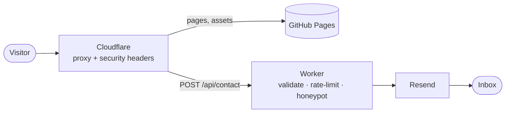
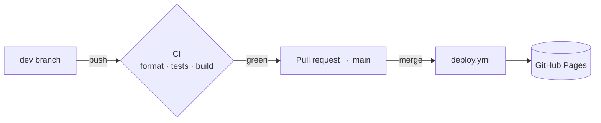

<div align="center">

</div>
<br>

<h1 align="center">Zoléni Kokolo Zassi — Portfolio</h1>

<p align="center">
  A bilingual (EN / FR) static portfolio, a learning journal and a contact form,<br />
  built with Astro and served through Cloudflare.
</p>

<p align="center">
  <a href="https://zolenikokolo.com"><b>zolenikokolo.com</b></a> ·
  <a href="https://zolenikokolo.com/fr/">version française</a> ·
  <a href="https://zolenikokolo.com/blog/">blog</a>
</p>

<div align="center">
  <p>
    <a href="https://zolenikokolo.com"></a>
    <a href="https://github.com/sikoso774/portfolio/actions/workflows/ci.yml"></a>
    
    
    
    
    
    <a href="LICENSE"></a>
  </p>
</div>

---

## At a glance

|                |                                                                |
| -------------- | -------------------------------------------------------------- |
| **What**       | Personal site: about, skills, experience, projects, blog, contact |
| **Languages**  | English at `/`, French at `/fr/`, one page file per route      |
| **Rendering**  | 100 % static (Astro), no framework runtime in the browser      |
| **Hosting**    | GitHub Pages behind Cloudflare, custom domain                  |
| **Form**       | Cloudflare Worker + Resend, same origin as the site            |
| **Quality**    | Prettier check, Vitest (real build), CI on every push to `dev` |

## How a request travels



## How a change ships



Work happens on `dev`. `main` is production: every push to it deploys, so it only ever
receives merged pull requests.

## Quick start

```bash
git clone https://github.com/sikoso774/portfolio.git
cd portfolio/frontend      # the Astro app lives here
npm install
npm run dev                # http://localhost:4321/
```

<details>
<summary><b>All commands</b></summary>

| Command                | What it does                                       |
| ---------------------- | -------------------------------------------------- |
| `npm run dev`          | Dev server on port 4321                            |
| `npm run build`        | Production build into `dist/`, plus the sitemap    |
| `npm run preview`      | Serve the build locally                            |
| `npm test`             | Vitest suite (builds the site, about 10 s)         |
| `npm run format`       | Prettier, write mode                               |
| `npm run format:check` | Prettier, check only (what CI runs)                |

</details>

<details>
<summary><b>Project structure</b></summary>

```text
.github/workflows/        ci.yml · deploy.yml
frontend/
├── src/
│   ├── pages/[...locale]/   every route, served in en and fr
│   ├── content/blog/{en,fr}/  Markdown articles, same slug in both
│   ├── i18n/                en.ts · fr.ts · blog.ts
│   ├── components/          Header, Hero, Footer, section previews
│   ├── layouts/Layout.astro head: SEO, Open Graph, JSON-LD, hreflang
│   ├── styles/global.css    :root variables and shared styles
│   └── scripts/main.js      scroll, mobile menu, animations
├── worker/                  Cloudflare Worker for the contact form
├── public/                  CNAME, robots.txt, favicons, assets/
├── scripts/                 generate-og.mjs (social card)
└── tests/                   blog · i18n · nav · seo · contact · hygiene
```

</details>

<details>
<summary><b>Design principles</b></summary>

- **No hardcoded colours.** Everything goes through `--clr-*` variables in `:root`;
  the light theme redefines the same variables.
- **No text in components.** Strings live in `src/i18n/{en,fr}.ts`; a missing key fails
  TypeScript and `tests/i18n.test.js`.
- **Trailing slash everywhere.** `trailingSlash: "always"`, canonicals and sitemap included.
- **No third-party scripts.** The font is self-hosted, the CSP is served by Cloudflare.

</details>

<details>
<summary><b>Contact form</b></summary>

The site is static, so the Resend API key cannot live in the page. The Worker receives
`POST /api/contact`, checks the origin, validates the fields, applies a per-IP rate limit,
silently drops submissions that fill the honeypot field, then sends the message through Resend.
It never logs message content. Full details in [`frontend/worker/README.md`](frontend/worker/README.md).

</details>

---

<p align="center">
  <sub>Copyright © 2026 Zoléni Kokolo Zassi. All rights reserved — see <a href="LICENSE">LICENSE</a>.</sub>
</p>
